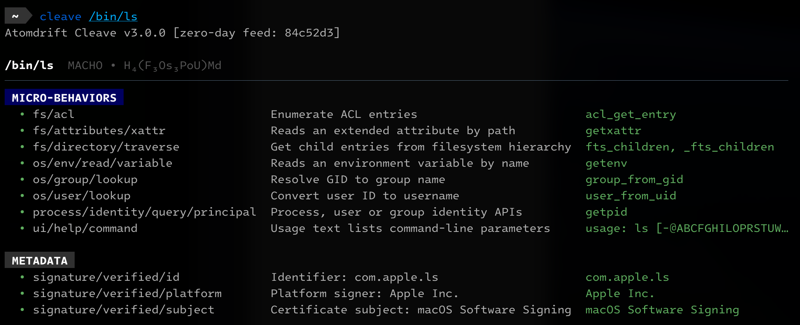
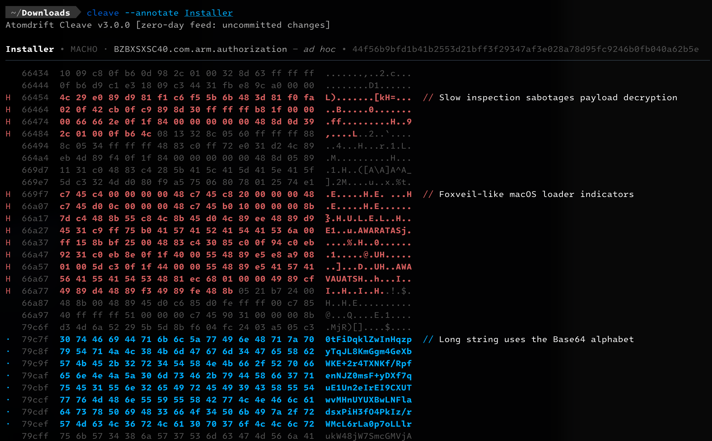
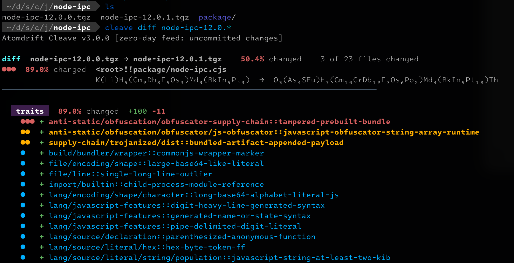

<p align="center"></p>

# cleave

[](https://github.com/atomdrift-project/cleave/releases/latest)
[](LICENSE)
[](https://www.bestpractices.dev/projects/16850)
[](https://rust-reportcard.xuri.me/report/github.com/atomdrift-project/cleave)

cleave is the closest thing a security-engineer has to X-Ray Vision: a static analyzer that reports the security-sensitive capabilities of a program. With over [170,000+ heuristic rules](https://github.com/atomdrift-project/traits) covering [100+ file formats](FILE_FORMATS.md), cleave handles anything from AppleScript to ELF binaries to VSIX extensions.

Designed originally for supply-chain attack detection, cleave is suitable for interactive use, differential analysis, and as part of a machine-learning pipeline. See [Atomdrift Scan](https://github.com/atomdrift-project/scan) for ML-based malware detection based on cleave.

Oh, and cleave is hella fast too - analyzing most programs in under 2 seconds. Here's the default view of /bin/ls:

<p align="center">
  

  The --annotate view, showing macho malware:

  

  And the diff subcommand, highlighting a supply-chain attack:


  
</p>

The trait hierarchy is inspired by MITRE's [Malware Behavior Catalog](https://github.com/MBCProject/mbc-markdown), and [Systema Naturae](https://en.wikipedia.org/wiki/Systema_Naturae) by Carl Linneaus.

## Install

To install on macOS, Linux, FreeBSD, or whatever UNIX flavor:

```bash
curl -fsSL https://install.atomdrift.org/cleave.sh | sh
```

For Windows:

```bash
irm https://install.atomdrift.org/cleave.ps1 | iex
```

To install from source instead (Rust 1.97 required):

```bash
make install
```

## Similar Tools

* [malcontent](https://github.com/chainguard-dev/malcontent) - our previous attempt at creating a multi-platform static analyzer; but the pure-YARA strategy didn't scale.
* [capa (Mandiant)](https://github.com/mandiant/capa/) - the original inspiration for malcontent and this project: slow and limited to PE/ELF/.NET binaries
* [OSSGadget (Microsoft)](https://github.com/microsoft/OSSGadget) - quite similar; but for only source languages.
* [maratus](https://github.com/0x4D31/maratus) - new! a static analyzer focused on macOS artifacts.
## License

cleave is available under the [Apache License 2.0](LICENSE).
